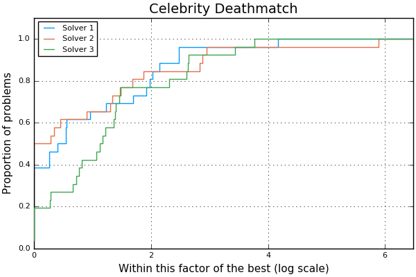

# [BenchmarkProfiles.jl documentation](@id Home)

A simple package to plot performance and data profiles.

This package containts Julia translations of original scripts by Elizabeth Dolan, Jorge Moré and Stefan Wild.
See [https://www.mcs.anl.gov/~wild/dfo/benchmarking](https://www.mcs.anl.gov/~wild/dfo/benchmarking).

The original code was not accompanied by an open-source license. Jorge Moré and Stefan Wild have kindly provided their consent in writing to allow distribution of this Julia translation. See [here](https://github.com/JuliaSmoothOptimizers/BenchmarkProfiles.jl/tree/main/consent) for a full transcription.

It appears that performance profiles date back to [at least 1996](https://dx.doi.org/10.1109/9.539425)!

Watch out for the [pitfalls](https://doi.org/10.1145/2950048) of profiles!

## How to Install

```julia
pkg> add BenchmarkProfiles
```

No plotting backend is loaded by default so the user can choose among several available plotting backends.
Currently, [Plots.jl](https://github.com/JuliaPlots/Plots.jl) and [UnicodePlots.jl](https://github.com/JuliaPlots/UnicodePlots.jl) are supported.
Backends become available when the corresponding package is imported.

## Example

```julia
julia> using BenchmarkProfiles
julia> T = 10 * rand(25,3);  # 25 problems, 3 solvers
julia> performance_profile(PlotsBackend(), T, ["Solver 1", "Solver 2", "Solver 3"], title="Celebrity Deathmatch")
ERROR: ArgumentError: The backend PlotsBackend() is not loaded. Please load the corresponding AD package.
julia> using Plots
julia> performance_profile(PlotsBackend(), T, ["Solver 1", "Solver 2", "Solver 3"], title="Celebrity Deathmatch")  # Success!
```



## Supported Backends

Currently supported backends are:

- [Plots.jl](https://github.com/JuliaPlots/Plots.jl);
- [UnicodePlots.jl](https://github.com/JuliaPlots/UnicodePlots.jl);
- [PGFPlotsX.jl](https://github.com/KristofferC/PGFPlotsX.jl).

Backends are treated as optional dependencies, but one is required to produce a plot.
The user should import one of the supported backends before calling one of the plotting functions.

## Exporting to TikZ

[`export_performance_profile_tikz`](@ref) writes a performance profile as a TikZ picture, to
include in a LaTeX document. It is available once [TikzPictures.jl](https://github.com/JuliaTeX/TikzPictures.jl)
is loaded, and does not need a plotting backend:

```julia
julia> using BenchmarkProfiles, TikzPictures
julia> T = 10 * rand(25, 3);  # 25 problems, 3 solvers
julia> export_performance_profile_tikz(T, "profile"; solvernames = ["Solver 1", "Solver 2", "Solver 3"])
```

This writes the TikZ code to `profile.tikz`, ready to `\input` in a document.
With `file_type = TEX` it writes a standalone `profile.tex` instead, and with
`file_type = PDF` or `file_type = SVG` a compiled figure. TikzPictures.jl compiles it with `lualatex`,
or with the Tectonic engine it ships when `lualatex` is not installed.
The colours, line styles, size of the figure and position of the legend are keyword arguments;
see [`export_performance_profile_tikz`](@ref) for all of them.

## Adding a New Backend

In order to add a new backend, there are two steps:

- Edit `src/BenchmarkProfiles.jl` to define the backend and make it available:

```julia
struct SomeNewPlotBackend <: AbstractBackend end
const bp_backends = [:PlotsBackend, :UnicodePlotsBackend, :SomeNewPlotBackend]
```

- Edit `src/requires.jl` to define how to produce the plot from the data:

```julia
@require SomeNewPlot = "91a5bcdd-55d7-5caf-9e0b-520d859cae80" begin
  function performance_profile_plot(
    ::SomeNewPlotBackend,
    x_plot,
    y_plot,
    max_ratio,
    xlabel,
    ylabel,
    labels,
    title,
    logscale;
    kwargs...,
  )
    #
    # now produce the plot and return the plot object
    #
  end

  function data_profile_plot(
    ::SomeNewPlotBackend,
    T,
    xs,
    max_data,
    xlabel,
    ylabel,
    labels,
    title;
    kwargs...,
  )
    #
    # do the same here
    #
  end
end
```

## References

- A. L. Tits and Y. Yang, _Globally convergent algorithms for robust pole assignment by state feedback_, IEEE Transactions on Automatic Control, 41(10), pages 1432&ndash;1452, 1996. DOI [10.1109/9.539425](https://dx.doi.org/10.1109/9.539425).
- E. Dolan and J. Moré, _Benchmarking Optimization Software with Performance Profiles_, Mathematical Programming 91, pages 201&ndash;213, 2002. DOI [10.1007/s101070100263](https://dx.doi.org/10.1007/s101070100263).
- J. J. Moré and S. M. Wild, _Benchmarking Derivative-Free Optimization Algorithms_, SIAM Journal on Optimization, 20(1), pages 172&ndash;191, 2009. DOI [10.1137/080724083](https://dx.doi.org/10.1137/080724083).
